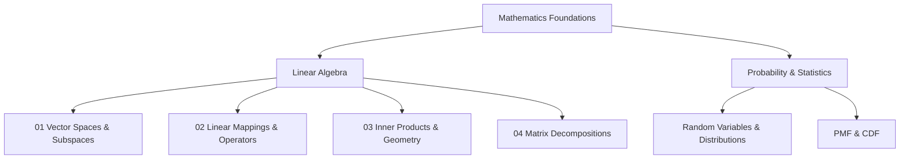

# Mathematics for Machine Learning & Core Foundations

> *"Mathematics helps me think critically and in first principles."*

### 📚 Primary Vault References
- **Linear Algebra Done Right** (Sheldon Axler) — [[BOOK - LINEAR ALGEBRA DONE RIGHT (Axler)]]
- **Mathematics for Machine Learning** (Marc Peter Deisenroth, A. Aldo Faisal, Cheng Soon Ong) — [[BOOK - MATHEMATICS FOR MACHINE LEARNING (Deisenroth)]]

---

## 📌 Linear Algebra

### 1. Vector Spaces & Subspaces
*   **Foundations:** [[Complex Numbers]], [[Groups]], [[Vector Spaces]], [[Vector Subspaces]]
*   **Core Mechanics:** [[Linear Independence]], [[Span and Bases]]

### 2. Linear Mappings & Operators
*   **Transformations:** [[Linear Mappings]], [[Symmetric, Definite and Positive Matrices]]

### 3. Inner Products & Analytical Geometry
*   **Geometry & Metrics:** [[Analytical Geometry Summary]], [[Norms]], [[Inner product]], [[Lengths and Distances]]

### 4. Spectral Theory & Matrix Decompositions
*   **Spectral Properties:** [[Determinants and Trace]], [[Eigenvectors and Eigenspectrum]], [[Diagonalization]]
*   **Decompositions:** [[Cholesky Decomposition]], [[Singular Value Decomposition]], [[Geometric Intuition of SVD]]

---

## 📌 Probability & Statistics
*   **Core Concepts:** [[Probability]], [[Random Variables and Distributions]]
*   **Distributions:** [[Probability Mass Functions (PMF)]], [[Cumulative Distribution Functions (CDF)]]

---

## 🗺️ Topic Map

