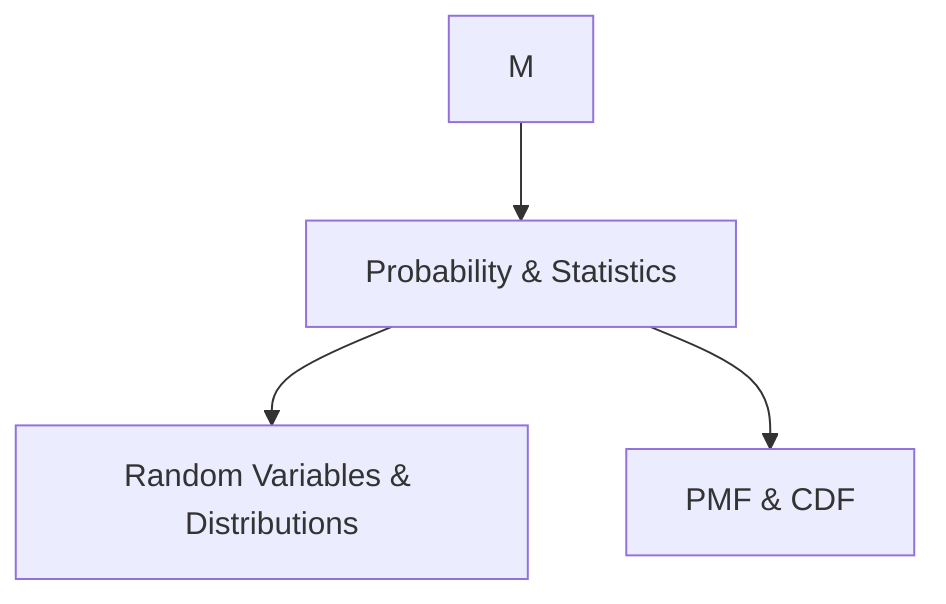

# Mathematics for Machine Learning & Core Foundations

> *"Mathematics helps me think critically and in first principles."*

### 📚 Primary Vault References
- **Linear Algebra Done Right** (Sheldon Axler) — [[BOOK - LINEAR ALGEBRA DONE RIGHT (Axler)]]
- **Mathematics for Machine Learning** (Marc Peter Deisenroth, A. Aldo Faisal, Cheng Soon Ong) — [[BOOK - MATHEMATICS FOR MACHINE LEARNING (Deisenroth)]]

---

## 📌 Probability & Statistics
*   **Core Concepts:** [[Probability]], [[Random Variables and Distributions]]
*   **Distributions:** [[Probability Mass Functions (PMF)]], [[Cumulative Distribution Functions (CDF)]]

---

## 🗺️ Topic Map

