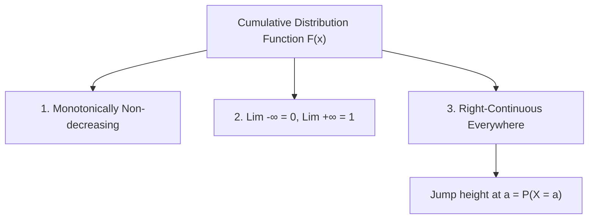

# Cumulative Distribution Functions (CDF)

In [[Probability]], the **Cumulative Distribution Function (CDF)** of a [[Random Variables and Distributions|Random Variable]] $X$ is the universal function that completely determines its probability distribution, whether $X$ is discrete, continuous, or mixed.

---

## 1. Formal Definition

The Cumulative Distribution Function $F_X: \mathbb{R} \to [0, 1]$ of a random variable $X$ is defined as:
$$F_X(x) = P(X \le x) = P(\{\omega \in \Omega : X(\omega) \le x\})$$

### Universal Applicability
Unlike the [[Probability Mass Functions (PMF)|PMF]] (which only exists for discrete RVs) or the PDF (which only exists for absolutely continuous RVs), **every single random variable has a CDF**.

---

## 2. The Three Fundamental Axiomatic Properties of a CDF

Any function $F: \mathbb{R} \to \mathbb{R}$ is a valid CDF if and only if it satisfies:

1. **Monotonically Non-Decreasing**:
   If $x_1 \le x_2$, then $F(x_1) \le F(x_2)$.
   *Proof Intuition*: The event $\{X \le x_1\} \subseteq \{X \le x_2\}$. By probability monotonicity, $P(X \le x_1) \le P(X \le x_2)$.

2. **Boundary Asymptotics**:
   $$\lim_{x \to -\infty} F(x) = 0 \quad \text{and} \quad \lim_{x \to \infty} F(x) = 1$$

3. **Right-Continuity (Continuous from the Right)**:
   For every $a \in \mathbb{R}$:
   $$\lim_{x \to a^+} F(x) = F(a)$$
   *(Note: A CDF does NOT have to be left-continuous. At jump discontinuities, the jump height equals $P(X = a)$).*

---

## 3. Extracting Probabilities from a CDF

Using the axioms of [[Kolmogorov Axioms and Probability Spaces]]:

1. **Interval $(a, b]$**:
   $$P(a < X \le b) = F_X(b) - F_X(a)$$
2. **Point Mass $P(X = a)$**:
   $$P(X = a) = F_X(a) - \lim_{x \to a^-} F_X(x) = F_X(a) - F_X(a^-)$$
   *For continuous RVs*, $F_X$ has no jumps $\implies P(X = a) = 0$ for all individual points.
3. **Strict Inequality $P(X < a)$**:
   $$P(X < a) = F_X(a^-) = \lim_{x \to a^-} F_X(x)$$
4. **Tail Probability $P(X > a)$**:
   $$P(X > a) = 1 - F_X(a)$$

---

## 4. Connection Between PMF and CDF (Discrete Case)

For a discrete random variable with PMF $p_X$:
$$F_X(x) = \sum_{t \le x} p_X(t)$$

The CDF of a discrete random variable is a **step function** (staircase) that:
- Is flat between support points.
- Jumps upward at each value $x$ in the support with jump size $p_X(x)$.

---

## 🔗 Related Notes
- Preceding: [[Random Variables and Distributions]]
- Companion: [[Probability Mass Functions (PMF)]]
- Theoretical Core: [[Kolmogorov Axioms and Probability Spaces]]
- Root: [[Probability]]
