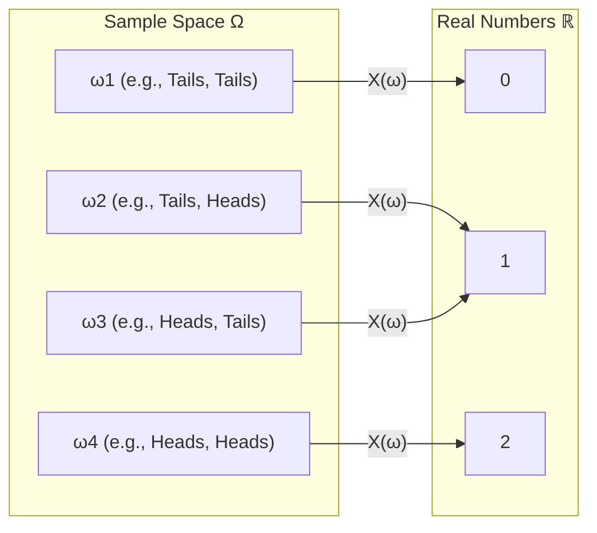

# Random Variables and Distributions

> *"A random variable is neither random nor a variable. It is a deterministic function."* — Joseph Blitzstein

In the study of [[Probability]], a **Random Variable (RV)** is a formal mathematical bridge that translates abstract outcomes from a sample space into quantifiable, real numbers.

---

## 1. Formal Definition

Given a probability space $(\Omega, \mathcal{F}, P)$ (see [[Kolmogorov Axioms and Probability Spaces]]), a **Random Variable** $X$ is a measurable function:
$$X: \Omega \longrightarrow \mathbb{R}$$

That is, for every elementary outcome $\omega \in \Omega$, $X(\omega)$ produces a single real number $x \in \mathbb{R}$.

### Why Call it "Measurable"?
To assign a probability to statements like $P(X \le x)$, the set of outcomes that map to $(-\infty, x]$ must actually belong to the event space $\mathcal{F}$:
$$\{\omega \in \Omega : X(\omega) \le x\} \in \mathcal{F}$$
In discrete probability, every subset of $\Omega$ is an event, so this technicality always holds. In continuous probability, this ensures no Banach-Tarski paradoxes occur.

---

## 2. What is a "Distribution"?

The **Distribution** of a random variable $X$ is the blueprint of how the probability mass of $1$ is distributed across the real line $\mathbb{R}$.

Two random variables $X$ and $Y$ can be completely different functions on completely different sample spaces, yet have the **same distribution**:
- Let $X$ be the outcome of a fair coin flip: $X(\text{Heads}) = 1, X(\text{Tails}) = 0$.
- Let $Y$ be whether a randomly drawn integer from $\{1, \dots, 100\}$ is even ($1$) or odd ($0$).
- Both $X$ and $Y$ follow the distribution $\text{Bernoulli}(0.5)$. We write:
$$X \sim \text{Bernoulli}(0.5), \quad Y \sim \text{Bernoulli}(0.5)$$
$$\text{Distributionally: } X \stackrel{d}{=} Y$$

---

## 3. Discrete vs. Continuous Random Variables

A random variable is classified by its **Support**—the set of all possible values $X$ can take with non-zero probability:

1. **Discrete Random Variable**:
   - The support is countable (finite or countably infinite, e.g., $\{0, 1, 2, \dots\}$).
   - Characterized by a [[Probability Mass Functions (PMF)|Probability Mass Function (PMF)]].
   - Examples: Number of words in a sentence, counts of tokens, classifications.
2. **Continuous Random Variable**:
   - The support is an uncountable interval of $\mathbb{R}$ (e.g., $[0, 1]$ or $\mathbb{R}$).
   - Individual points have probability zero: $P(X = x) = 0$.
   - Characterized by a Probability Density Function (PDF) and a [[Cumulative Distribution Functions (CDF)|Cumulative Distribution Function (CDF)]].
   - Examples: Neural network weights, latent embeddings, loss values.

---

## 4. Why This Matters in Machine Learning

* **Representations**: In deep learning, an input image $\mathbf{x} \in \mathbb{R}^D$ is modeled as a realization of a continuous random vector $\mathbf{X}$.
* **Classification**: In multi-class classification, the network predicts the parameter vector $\mathbf{p} = [p_1, \dots, p_K]$ of a Categorical random variable over the labels $\{1, \dots, K\}$.
* **Latent Variables**: In Variational Autoencoders (VAEs), latent codes $\mathbf{z} \sim \mathcal{N}(\boldsymbol{\mu}, \boldsymbol{\Sigma})$ are continuous random vectors mapped deterministically by the decoder network to generate data.

---

## 🔗 Related Notes
- Root: [[Probability]]
- Next: [[Probability Mass Functions (PMF)]]
- Next: [[Cumulative Distribution Functions (CDF)]]
- ML Context: [[BOOK - MATHEMATICS FOR MACHINE LEARNING (Deisenroth)]]
